  

  

  
  
  
  

---

### 👨‍💻 Sobre mí

Ingeniero de software **full-stack** con más de 4 años construyendo productos completos: del diseño de la API
y el modelo de datos hasta el despliegue y el mantenimiento en producción.
Integro **agentes LLM**, **MCP** y flujos con **n8n** donde aportan valor real, y trabajo con herramientas
agénticas como Claude Code y Codex para orquestar subagentes y revisar código.

- 🏥 Ahora mismo: ingeniero de software en [**InvokeIA**](https://www.invokeia.com), una plataforma de gestión clínica y automatización con IA
- 🦀 En mis ratos libres: [**Aurora**](https://github.com/YoshiLoL0526/aurora), UIs de escritorio para Python con núcleo nativo en Rust
- 🧠 Me interesa: agentes, RAG, búsqueda vectorial y arquitectura que aguante producción
- 🌎 Curitiba, Brasil · remoto · 🇪🇸 nativo · 🇬🇧 B2 · 🇧🇷 A2
- ☕ Funciono a café

### 🛠️ Stack

  
  
  
  
  
  
  
  
  
  
  
  

### 🚀 Proyectos destacados

| Proyecto | Qué es | Stack |
|---|---|---|
| [**Aurora**](https://github.com/YoshiLoL0526/aurora) | Framework de UI de escritorio para Python, declarativo y reactivo, con núcleo nativo en Rust y sin WebView. Incluye layout flexbox, render con Skia, animaciones, temas y charts para millones de puntos. | Python · Rust · Skia · Taffy |
| [**InvokeIA**](https://raidel-martinez.dev/es/projects/invokeia/) | Plataforma de gestión clínica con IA: agenda, historia clínica, facturación, workflows y agentes. | Next.js · n8n · FastAPI · PostgreSQL |
| [**Vaelgrim**](https://raidel-martinez.dev/es/projects/vaelgrim/) | RPG idle de navegador con servidor autoritativo, PvP, subasta, temporadas y battle pass. | TypeScript · PixiJS · Fastify · WebSocket |
| [**Rec Studio**](https://raidel-martinez.dev/es/projects/rec-studio/) | Grabador y editor de pantalla para Windows construido sobre Aurora, con timeline y exportación a MP4. | Python · Aurora · FFmpeg · PyAV |
| [**Agents Team**](https://github.com/YoshiLoL0526/agents-team) | Orquestación de un equipo de agentes LLM. | Python |

Más proyectos en <a href="https://raidel-martinez.dev/es/projects/">raidel-martinez.dev/projects</a>

### 🔥 En lo que trabajo últimamente

<!-- REPOS:START -->
- **[vaelgrim-website](https://github.com/YoshiLoL0526/vaelgrim-website)** `TypeScript · ⭐ 0`
- **[my-portfolio](https://github.com/YoshiLoL0526/my-portfolio)** `Astro · ⭐ 0` — Personal portfolio of Raidel Martínez Santos — trilingual (ES/EN/PT) static site built with Astro, TypeScript and Tailwind CSS. Content collections, View Transitions, command palette and auto-generated PDF CVs.
- **[screen-recorder](https://github.com/YoshiLoL0526/screen-recorder)** `Python · ⭐ 0` — Aplicación de escritorio para grabar la pantalla y editar el resultado sin salir de la app. Toda la interfaz está construida con aurora-ui.
- **[aurora](https://github.com/YoshiLoL0526/aurora)** `Python · ⭐ 5` — UI de escritorio declarativa y reactiva para Python, con núcleo nativo en Rust. Layout flexbox (Taffy), render con Skia, animaciones, temas, canvas y gráficos de millones de puntos.
- **[planify](https://github.com/YoshiLoL0526/planify)** `TypeScript · ⭐ 0`
<!-- REPOS:END -->

### ⚡ Actividad reciente

<!-- ACTIVITY:START -->
- 🔨 Hizo push a [YoshiLoL0526/screen-recorder](https://github.com/YoshiLoL0526/screen-recorder)
- 🔨 Hizo push a [YoshiLoL0526/aurora](https://github.com/YoshiLoL0526/aurora)
- 🚀 Publicó [v0.10.0](https://github.com/YoshiLoL0526/aurora/releases/tag/v0.10.0) en [YoshiLoL0526/aurora](https://github.com/YoshiLoL0526/aurora)
- 🚀 Publicó [v0.9.1](https://github.com/YoshiLoL0526/aurora/releases/tag/v0.9.1) en [YoshiLoL0526/aurora](https://github.com/YoshiLoL0526/aurora)
- 🚀 Publicó [v0.9.0](https://github.com/YoshiLoL0526/aurora/releases/tag/v0.9.0) en [YoshiLoL0526/aurora](https://github.com/YoshiLoL0526/aurora)
<!-- ACTIVITY:END -->

### 📊 Números

  <picture>
    <source media="(prefers-color-scheme: dark)" srcset="https://raw.githubusercontent.com/YoshiLoL0526/YoshiLoL0526/output/stats-dark.svg" />
    
  </picture>
  <picture>
    <source media="(prefers-color-scheme: dark)" srcset="https://raw.githubusercontent.com/YoshiLoL0526/YoshiLoL0526/output/top-langs-dark.svg" />
    
  </picture>

  <picture>
    <source media="(prefers-color-scheme: dark)" srcset="https://raw.githubusercontent.com/YoshiLoL0526/YoshiLoL0526/output/snake-dark.svg" />
    
  </picture>

Repos, actividad y estadísticas se actualizan solos cada 6 horas vía GitHub Actions 🤖

